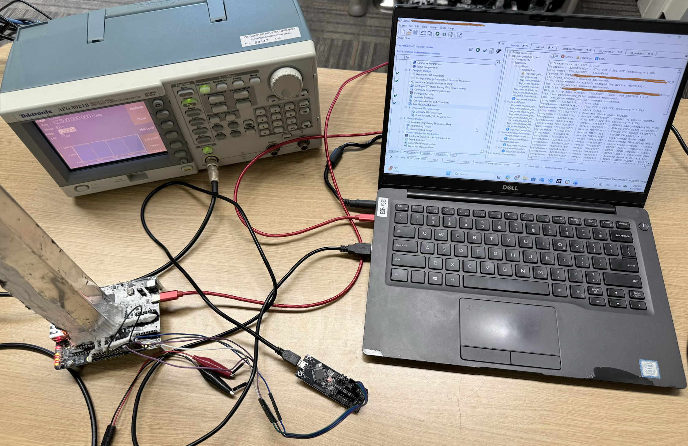
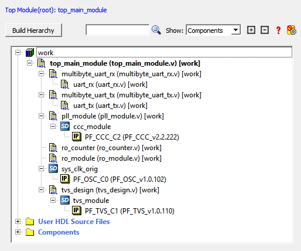
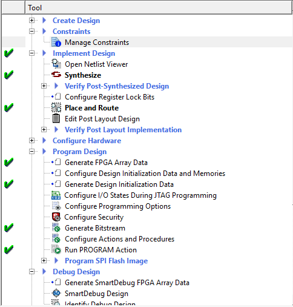
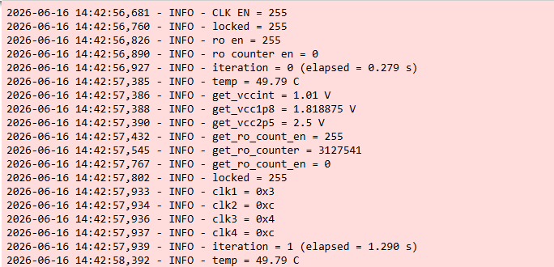

# Microchip Discovery Kit
This folder has Verilog modules for the Microchip PolarFire target.  
The code is for experiments with on-chip sensors and clocks.  
It focuses on cryogenic and varied temperature tests.

## Implementation setup
- Hardware: Microchip PolarFire MPFS095T-1FCSG325E.
- Setup:
   

> [!NOTE]
> In our design, we used the Raspberry Pi header pins and ESP-Prog for UART communication. However, you can also use the UART pins provided by the PolarFire Discovery Kit.

> [!IMPORTANT]
> Also, to ensure reliable UART communication in our experiments, we used an external 12.5 MHz clock from a function generator. However, you can replace it with an internal clock depending on your project requirements.

## Top-level
- File: top_main_module.v.  
- Expected signals:
  - clk: external clock input (12.5 MHz expected).  
  - rst: synchronous reset.  
  - uart_rx_line / uart_tx_line: UART RX/TX.  
  - clk_out: PLL clock output.  
  - ro_out: ring-oscillator output.  
  - temp_low / temp_high: threshold outputs.

The top module has a UART command interface.  

## Verilog sources
- RTL files are in the `implementation/rtl/` folder.  
- Constraint files are in the `implementation/constraint/` folder.

## Catalog IPs used
- Temperature / Voltage Sensor (TVS).  
- Clock Conditioning Circuitry (CCC).  
- RC Oscillators Configurator (OSC-2MHz).
- See `implementation/component/` folder

## Host communication / Python
- Host talks to the FPGA using UART.  
- Python code is in `data_collection/`.  
- The notebook plots the results at the end.

## How to Program the Microchip PolarFire Discovery Kit

Follow the steps below to program the Microchip PolarFire Discovery Kit using Libero SoC.

### Step-by-step Instructions

1. Clone this GitHub repository or download the ZIP file and extract it.

2. Open **Libero SoC** and create a new project.

3. Import all files from the `implementation/rtl` folder into your Libero project.

4. Copy all files from the `implementation/component` folder in this repository into the `component/work` directory of your new Libero project. Then import all the .cxf files using `Import Component` under File.

5. In the **Design Hierarchy** window, Press `Build Hierarchy`. Set the `top_main_module` as a root. Then expand the hierarchy and open all IP catalog components.
   Then, generate the SmartDesign components that have a red box next to them.

6. Import the constraint files, including both the I/O constraints and timing constraints.

7. Run **Synthesis**.

8. Open **Manage Constraints** and select the appropriate constraint files for **Place and Route**.

9. Click **Generate Bitstream**.  
   After the bitstream is generated successfully, click **Run PROGRAM Action** to program the board.

10. Open the provided Python script and use it for communication with the board.  
    Make sure to update the serial port number based on the port assigned to your board in **Device Manager**.

<table>
  <tr>
    <td align="center">
       
      <b>Hierarchy Design</b>
    </td>
    <td align="center">
       
      <b>Design Flow</b>
    </td>
    <td align="center">
       
      <b>Python Log File</b>
    </td>
  </tr>
</table>

## Contact / Contributing

## Paper 

## License
